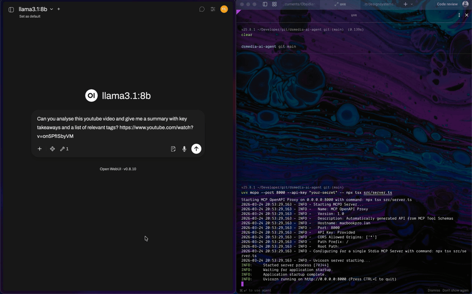
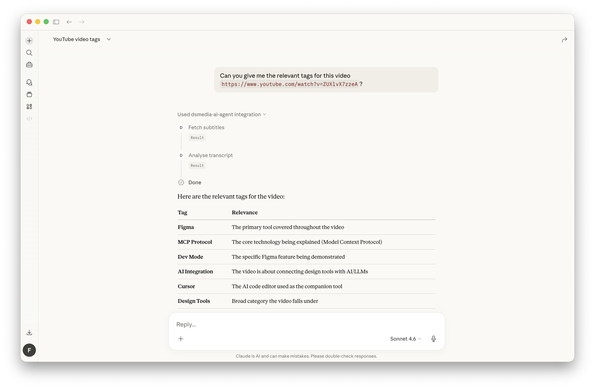

# DS.media AI Agent

A Node.js + TypeScript YouTube ingest pipeline that exposes one shared workflow through four aligned surfaces:

- MCP tools
- CLI commands
- skill manifests and markdown guidance
- configurable Ollama-backed LLM runtime

The repo ingests a YouTube video, produces transcript artifacts, and writes structured JSON analysis keyed by the canonical YouTube video ID.





## What The Pipeline Does

For each video, the pipeline:

1. Resolves the canonical YouTube video ID
2. Downloads audio with `yt-dlp` when needed
3. Prefers YouTube subtitles or auto-captions when available
4. Falls back to Whisper transcription when subtitles are unavailable
5. Sends the transcript to a local Ollama model
6. Writes validated JSON to `data/analysis/<videoId>.json`

For long transcripts, the analysis step now summarizes the transcript in chunks before the final structured JSON pass so smaller local models are less likely to return truncated JSON.

Artifact paths are stable and source-linked:

- `data/audio/<videoId>.mp3`
- `data/descriptions/<videoId>.txt`
- `data/metadata/<videoId>.json`
- `data/notes/<videoId>.md`
- `data/transcripts/<videoId>.txt`
- `data/transcripts/<videoId>*.vtt`
- `data/analysis/<videoId>.json`
- `data/embeddings/<videoId>.json` (cached search embedding, see "Finding content" below)

When subtitles are available, the pipeline keeps one preferred English `.vtt` variant for the video and removes the rest.

## Requirements

- Node.js
- `yt-dlp`
- `whisper` from `openai-whisper`
- Ollama running locally
- At least one Ollama model installed
- `nomic-embed-text` pulled in Ollama if you want to use `find_content` (`ollama pull nomic-embed-text`) - chat models can't serve embeddings, so this is a separate, dedicated pull

Recommended default profile for a 16 GB Apple Silicon machine:

- `balanced` → `llama3.1:8b` (verified locally in this repo)

Other built-in profiles:

- `fast` → `gemma3:4b` (available, not yet locally validated here)
- `quality` → `qwen3:8b` (available, not yet locally validated here)

## Install

Install project dependencies:

```sh
npm install
```

Install external tools:

```sh
brew install yt-dlp
brew install openai-whisper
```

Confirm Ollama is running and has a model:

```sh
ollama list
```

## Configuration

LLM configuration is layered in this order:

1. explicit runtime override
2. environment variables
3. `dsmedia.config.json`
4. built-in defaults

The checked-in project config is:

```json
{
  "llm": {
    "provider": "ollama",
    "baseUrl": "http://localhost:11434",
    "profile": "balanced",
    "temperature": 0.2,
    "structuredOutput": true
  }
}
```

Supported environment variables:

- `DSMEDIA_LLM_PROFILE`
- `DSMEDIA_LLM_MODEL`
- `DSMEDIA_LLM_BASE_URL`
- `DSMEDIA_LLM_TEMPERATURE`
- `DSMEDIA_LLM_NUM_CTX`
- `DSMEDIA_LLM_STRUCTURED_OUTPUT`
- `DSMEDIA_LLM_EMBEDDING_MODEL` (used by `find_content`; see "Finding content" below)

Examples:

```sh
DSMEDIA_LLM_PROFILE=fast npm run ingest_video -- 'https://www.youtube.com/watch?v=5MK3SkNST-0'
```

```sh
DSMEDIA_LLM_MODEL=llama3.1:8b npm run ingest_video -- 'https://www.youtube.com/watch?v=5MK3SkNST-0'
```

## CLI

The CLI now uses canonical command names that match the shared runtime registry.

Single video:

```sh
npm run ingest_video -- 'https://www.youtube.com/watch?v=5MK3SkNST-0'
```

Batch ingest:

```sh
npm run ingest_batch -- 'https://www.youtube.com/playlist?list=PLxxxxxxxx'
```

Batch ingest also accepts:

- a channel URL
- a single video URL
- a text file with one URL per line

Compatibility alias for the old single-video entrypoint:

```sh
npm run ingest -- 'https://www.youtube.com/watch?v=5MK3SkNST-0'
```

Direct CLI usage without npm scripts:

```sh
node --import tsx src/cli.ts ingest_video '<youtube-url>'
node --import tsx src/cli.ts ingest_batch '<playlist-url-or-file>'
```

### Step-by-step CLI testing

Each MCP tool can also be tested from the command line with the same canonical name:

```sh
npm run parse_video_id -- '<youtube-url>'
npm run download_audio -- '<youtube-url>'
npm run fetch_description -- '<youtube-url>'
npm run fetch_subtitles -- '<youtube-url>'
npm run transcribe_audio -- '<youtube-url>'
npm run analyse_transcript -- '<youtube-url>' 'data/transcripts/<videoId>.txt'
npm run write_video_summary -- '<youtube-url>'
npm run expand_playlist -- '<playlist-or-channel-url>'
npm run find_content -- '<natural-language request>' [--limit N]
```

Expected behavior by step:

- `parse_video_id` returns the canonical video id plus expected artifact paths.
- `download_audio` writes `data/audio/<videoId>.mp3`.
- `fetch_description` writes `data/descriptions/<videoId>.txt` when a description is available.
- `write_video_summary` writes `data/notes/<videoId>.md`, reusing or generating any missing transcript, analysis, description, and metadata artifacts as needed.
- `fetch_subtitles` writes `data/transcripts/<videoId>.txt` and keeps one preferred English `.vtt` file when subtitles are available.
- `transcribe_audio` produces `data/transcripts/<videoId>.txt`, using subtitles first and Whisper as fallback.
- `analyse_transcript` reads transcript text from the file path you pass and writes `data/analysis/<videoId>.json`, including the cached YouTube description for later reference.
- `expand_playlist` returns a flat list of video ids, URLs, and titles.
- `find_content` searches `data/analysis/*.json`, plus designsystems.media's own frontmatter as a fallback, for videos relevant to a natural-language request, and returns a short conversational recommendation plus the matching videos. See "Finding content" below.

## Finding content

`find_content` turns the library into a chat-style discovery tool: describe what you're looking for and it returns a short recommendation grounded in real matches, with links.

```sh
npm run find_content -- 'something practical on getting engineering buy-in for a design system' --limit 5 [--site-path <path>]
```

It searches two sources, merged into one corpus:

1. Every cached analysis artifact under `data/analysis` (summary, tags, key takeaways from `analyse_transcript`), joined with its title from `data/metadata` when available.
2. As a fallback, for anything not yet analysed: designsystems.media's own frontmatter directly - title, tags, closed-taxonomy values (`series`/`topics`/`tools`/`systems`), speakers, and body text, read from the sibling site checkout (same default/override as `classify_taxonomy`/`retag_site_media`: a sibling directory, `DSMEDIA_SITE_DIR`, or `--site-path`). Most media entries are already tagged from the retagging pass, so this covers nearly the whole site without re-running ingest on anything. If the site checkout isn't found, this source is silently skipped rather than failing the search - `data/analysis` alone is still searched.

Then:

3. Embeds every entry with a dedicated Ollama embedding model (`nomic-embed-text` by default, configurable via `DSMEDIA_LLM_EMBEDDING_MODEL`), caching the vector at `data/embeddings/` keyed by a hash of the embedded text - an unchanged entry is never re-embedded on a later search.
4. Embeds the query the same way and ranks the merged corpus by cosine similarity.
5. Asks the resolved chat model (your normal `balanced`/`fast`/`quality` profile) to write a short, conversational recommendation grounded only in the top matches, citing titles and a URL or two.

Embedding and chat models are different model types in Ollama - a chat model like `llama3.1:8b` can't serve `/api/embeddings` at all, so this needs `nomic-embed-text` (or whatever embedding model you configure) pulled separately: `ollama pull nomic-embed-text`.

This doesn't ingest anything itself - run `ingest_video`/`ingest_batch`/`retag_site_media` to actually produce `data/analysis` artifacts. It's also local-only for now: the MCP tool is reachable from Claude Desktop/Open WebUI chats, not from designsystems.media itself, since site visitors won't have a local Ollama to call.

## Retagging designsystems.media against its closed taxonomy

designsystems.media's content schema (`src/content.config.ts`) enforces a closed
taxonomy for `series`/`topics`/`tools`/`systems` (defined in
`src/lib/content-domain/taxonomy.ts`, see ADR 0012/0014), plus a freeform
`tags` field for anything that doesn't fit, and a controlled `speakers` list
(`frontmatter.json`). Two commands here bridge this repo's ingest pipeline
into that site so existing untagged entries can be classified in bulk instead
of by hand:

- `classify_taxonomy` - classifies a single video against the site's closed
  taxonomy (reusing or generating its cached analysis first) and returns the
  result. Doesn't write to any site file - useful for previewing what a
  video would get tagged before running the batch command.
- `retag_site_media` - scans designsystems.media's `media` (or `podcast`)
  collection for entries missing all of `series`/`topics`/`tools`/`systems`,
  runs each through the ingest + classification pipeline, and writes the
  results back into that entry's frontmatter. Entries missing `speakers` also
  get a best-effort speaker proposal, but only written if it confidently
  matches an existing name in `frontmatter.json`'s speaker list - anything
  else is left for manual review rather than guessed into a controlled field.
  **Dry-run by default** (add `--apply` to actually write); every run also
  writes a JSON report to `data/retag-reports/`.

By default the site is expected to be a sibling checkout at
`../designsystems.media`. Override with `--site-path <path>` or the
`DSMEDIA_SITE_DIR` environment variable.

```sh
# Preview one video's taxonomy classification without touching any file
npm run classify_taxonomy -- 'https://www.youtube.com/watch?v=5sEQzF7tgmk'

# Dry run over the first 5 untagged media entries - prints what would change
npm run retag_site_media -- --limit 5

# Test against a single entry before running the full batch
npm run retag_site_media -- --only 10-design-system-consulting --apply

# Actually retag every untagged media entry
npm run retag_site_media -- --apply

# Same, but for the podcast collection, against a non-sibling checkout
npm run retag_site_media -- --kind podcast --site-path /path/to/designsystems.media --apply
```

Values the model proposes that don't verbatim match a closed-list entry are
never silently dropped - they fall through into that entry's `tags` field
instead, and are also listed under `droppedValues` in the report so you can
spot recurring near-misses that might be worth adding to the taxonomy for
real (per ADR 0012's "when nothing fits" guidance).

## MCP

Start the MCP server:

```sh
npm run server
```

The server communicates over stdio and exposes these tools from the shared registry:

- `parse_video_id`
- `download_audio`
- `fetch_description`
- `write_video_summary`
- `fetch_subtitles`
- `transcribe_audio`
- `analyse_transcript`
- `expand_playlist`
- `classify_taxonomy`
- `find_content`

`retag_site_media` is CLI-only (it's a long-running batch job over many
videos, same reasoning as `ingest_batch`).

### Test With MCP Inspector

```sh
npx @modelcontextprotocol/inspector node --import tsx src/server.ts
```

### Claude Desktop

Add this to `claude_desktop_config.json` with your absolute repo path:

```json
{
  "mcpServers": {
    "dsmedia-ai-agent": {
      "command": "/opt/homebrew/bin/node",
      "args": [
        "--import",
        "tsx",
        "/absolute/path/to/repo/src/server.ts"
      ]
    }
  }
}
```

Restart Claude Desktop after saving the config.

### Open WebUI

Open WebUI expects an HTTP-facing MCP endpoint. Use `mcpo` as a proxy:

```sh
uvx mcpo --port 8000 --api-key "your-secret" -- node --import tsx src/server.ts
```

Then point Open WebUI at `http://localhost:8000`.

## Skills

This repo is also a Claude Code plugin (`.claude-plugin/plugin.json`, name `dsmedia`). Each skill is a folder under `skills/` with a `SKILL.md`, and has a machine-readable manifest in `skill/<name>.manifest.json`.

| Skill | Use it to |
|---|---|
| `ingest-video` | Ingest, transcribe, and analyse one YouTube video |
| `ingest-batch` | Ingest a playlist, a channel, or a list of URLs |
| `tag-media-entry` | Preview how one video would be tagged (read-only) |
| `retag-site-media` | Bulk-tag untagged site entries: dry run, review, then `--apply` |
| `find-content` | Find videos by meaning and get a short recommendation |
| `add-speaker` | Add a name to the site's controlled speakers list |

`formats/video-summary.md` is the vault note template.

`npm run validate` checks that every manifest has a matching `skills/<id>/SKILL.md` with the same `name`, and that every MCP tool and CLI command is covered by at least one manifest. Adding a tool without updating the skills fails validation.

Portability is handled in layers:

- MCP makes the executable tool interface portable across Claude and other MCP-aware clients.
- Skill manifests make the workflow metadata portable across different AI tool ecosystems.
- Markdown skill files remain the human-facing guidance layer.

## Output Schema

`data/analysis/<videoId>.json` has this shape:

```json
{
  "id": "string",
  "source_url": "string",
  "description": "string | null",
  "summary": "string",
  "tags": ["string"],
  "key_takeaways": ["string"]
}
```

## Validation And Tests

Type-check:

```sh
npm run typecheck
```

Validate registry and skill-manifest wiring:

```sh
npm run validate
```

Run tests:

```sh
npm test
```
